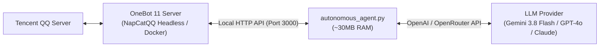

# QQ AI Companion Framework

<div align="center">

[](https://opensource.org/licenses/MIT)
[](https://www.python.org/downloads/)
[](https://11.onebot.dev/)
[]()

**A high-performance, ultra-lightweight , 24/7 autonomous multimodal AI companion framework for QQ based on OneBot 11.**

[English](README.md) | [简体中文](README_CN.md)

</div>

---

## 🌟 Key Features

* **⚡ Ultra-Low RAM Footprint**:
  * Core Python daemon consumes **only ~30MB RAM**, perfect for running 24/7 on low-cost Linux VPS (1 vCPU / 512MB-1GB RAM).
* **🧠 Dynamic Long-Term Memory & Real-Time Memorization**:
  * Dual-layer memory architecture: maintains recent dialogue turns in `history.json` while allowing the model to instantly memorize new facts via `[Update Memory: ...]` into `memory_summary.txt`. Auto-Compact compresses older turns without overflowing token limits!
* **📜 Full Chat History Persistence & Search**:
  * Permanently logs all conversations to `chat_history.jsonl` with timestamps. The model can search past dialogue anytime via `[Search History: keyword]`.
* **🔍 Live Web Search**:
  * Built-in real-time web search (`[Search: query]`), enabling the companion to fetch latest news, weather, technical facts, and real-time knowledge.
* **🚀 Smart Message Debounce & Non-Dropping Queue**:
  * Rapid bursts of messages are cleanly combined into cohesive context. Queue protection ensures no messages are discarded or forgotten.
* **👁️ Multimodal Vision (Zero-Fail Fallback)**:
  * Automatically downloads images/memes with custom HTTP headers, backed by direct local disk retrieval via OneBot `get_image` API.
* **🎙️ Voice Messages (Edge-TTS)**:
  * Generates native QQ voice messages via Microsoft Edge Neural TTS (`zh-CN-XiaoyiNeural`, `zh-CN-XiaoxiaoNeural`, etc.). Completely free, GPU-less, and realistic.
* **🔌 Native MCP Server (Model Context Protocol)**:
  * Includes `mcp-server/onebot_mcp.py` for direct integration with Claude Desktop, Cursor, Antigravity, and other MCP clients.
* **🎭 Model-Agnostic Persona Engine**:
  * Persona, tone, and action guidelines are stored in `persona/*.md`. Hot-reloads on every message with human-like conversation style (no repetitive emoji suffixes, flexible lengths).
* **🏷️ Rich Action Tags**:
  * Supports inline tags for QQ Yellow Faces (`[Send Face: Hug]`), custom stickers (`[Send Sticker: Heart]`), voice notes (`[Send Voice: ...]`), and interactions (`[Interact: Poke]`).
* **🌐 Cross-Platform & Headless Server Ready**:
  * Runs on Windows, Debian, Ubuntu, CentOS, or Docker with terminal ASCII QR code login.

---

## 🏗️ Architecture



---

## 🚀 Quick Start

Getting started takes just two simple steps:

### Step 1: Automated All-in-One Setup
Clone the repository and run the setup script:

```bash
git clone https://github.com/intfloatjohn/AI2QQ.git
cd AI2QQ
chmod +x setup.sh start.sh
./setup.sh
```

`setup.sh` automatically handles **everything** out of the box:
* 📦 Installs required system packages (`python3`, `python3-venv`, `ffmpeg`, `curl`)
* 🐍 Sets up a Python virtual environment (`venv/`) and installs all dependencies
* 🎙️ Pre-caches & verifies the Microsoft Edge Neural TTS voice engine
* 🔍 Tests live web search connectivity
* 🐳 Configures & launches the NapCatQQ (OneBot 11) Docker container with terminal ASCII QR code login
* ⚙️ Initializes `config.json` automatically

> **Note**: Edit `config.json` to configure your `api_key` (OpenRouter / Gemini API Key) and `master_qq` (your QQ number):
```json
{
  "api_key": "YOUR_API_KEY_HERE",
  "master_qq": 123456789,
  "model": "google/gemini-3.8-flash"
}
```

### Step 2: Daily Launch & Restart
Whenever you reboot your server or restart the bot, simply run:

```bash
./start.sh
```
*`start.sh` automatically checks NapCat Docker status, wakes up the container if stopped, activates the virtual environment, and boots the companion daemon.*

---

#### 🪟 Windows Setup & Daily Launch
1. **First-time Setup**: Double-click **`setup_windows.bat`** (initializes venv, installs requirements, pre-caches TTS voice, and downloads NapCat).
2. **Configure**: Fill in your `api_key` and `master_qq` in `config.json`.
3. **Daily Launch**: Double-click **`start.bat`** (or `start_agent.bat`) anytime!

---

## 🐧 Headless Linux (Debian / Ubuntu) Deployment

### 1. Run NapCat in Docker (Terminal QR Login)
```bash
docker run -d \
  --name napcat \
  --restart always \
  --network host \
  -v /opt/napcat/config:/app/napcat/config \
  mlikiowa/napcat-docker:latest
```
Scan the ASCII QR Code printed in terminal:
```bash
docker logs -f napcat
```
The terminal will print a black-and-white ASCII QR code; scan it with mobile QQ to log in instantly!

### 2. Run Companion as a Systemd Service
```bash
chmod +x deploy_debian.sh start_agent.sh
./deploy_debian.sh

# Install systemd service
sudo cp qq-companion.service /etc/systemd/system/
sudo systemctl daemon-reload
sudo systemctl enable --now qq-companion
```

---

## 📖 Documentation

* [User Guide (English)](USAGE_EN.md) / [用户使用手册 (中文)](USAGE.md): Detailed architectural guide covering persona customization, auto-compact memory, multimodal audio, autonomous visual library, multi-bubble typing, and MCP integration.
* [Stickers Guide (stickers/STICKERS_GUIDE.md)](stickers/STICKERS_GUIDE.md): How to manage image sticker packs.

---

## ⚖️ Legal & Licensing

This project is licensed under the **[MIT License](LICENSE)**.
