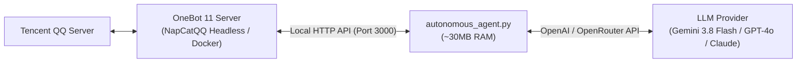

# QQ AI Companion Framework

<div align="center">

[](https://opensource.org/licenses/MIT)
[](https://www.python.org/downloads/)
[](https://11.onebot.dev/)
[]()

**A high-performance, ultra-lightweight , 24/7 autonomous multimodal AI companion framework for QQ based on OneBot 11.**

[English](README.md) | [简体中文](README_CN.md)

</div>

---

## 🌟 Key Features

* **⚡ Ultra-Low RAM Footprint**:
  * Core Python daemon consumes **only ~30MB RAM**, perfect for running 24/7 on low-cost Linux VPS (1 vCPU / 512MB-1GB RAM).
* **🧠 Auto-Compact Long-Term Memory**:
  * Dual-layer memory architecture: maintains recent dialogue turns in `history.json` while automatically consolidating older turns into persistent facts in `memory_summary.txt`. Never forgets user preferences or past events without overflowing token limits!
* **🚀 Smart Debounce & Real-Time Interruption**:
  * Automatically bundles rapid consecutive messages into a single prompt. If newer messages arrive while the LLM is generating, the daemon immediately cancels outdated processing and synthesizes the updated batch.
* **👁️ Multimodal Vision (Zero-Fail Fallback)**:
  * Automatically downloads images/memes with custom HTTP headers, backed by direct local disk retrieval via OneBot `get_image` API.
* **🎙️ Voice Messages (Edge-TTS)**:
  * Generates native QQ voice messages via Microsoft Edge Neural TTS (`zh-CN-XiaoyiNeural`, `zh-CN-XiaoxiaoNeural`, etc.). Completely free, GPU-less, and realistic.
* **🎭 Model-Agnostic Persona Engine**:
  * Persona, tone, and action guidelines are stored in `persona/*.md`. Hot-reloads on every message — change models (Gemini 3.8 Flash, GPT-4o, Claude, DeepSeek) seamlessly with instant adaptation!
* **🏷️ Rich Action Tags**:
  * Supports inline tags for QQ Yellow Faces (`[Send Face: Hug]`), custom stickers (`[Send Sticker: Heart]`), voice notes (`[Send Voice: ...]`), and interactions (`[Interact: Poke]`).
* **🌐 Cross-Platform & Headless Server Ready**:
  * Runs on Windows, Debian, Ubuntu, CentOS, or Docker with terminal ASCII QR code login.

---

## 🏗️ Architecture



---

## 🚀 Quick Start

### 1. Requirements
* Python 3.9+ (tested up to 3.14)
* A running OneBot 11 implementation (e.g. [NapCatQQ](https://github.com/NapNeko/NapCatQQ) in Docker or native) (No manual configuration needed; setup scripts configure this automatically)

### 2. Installation
```bash
# Clone the repository
git clone https://github.com/your-username/qq-ai-companion.git
cd qq-ai-companion

# Install dependencies
pip install -r requirements.txt
```

### 3. Configuration
Copy `config.example.json` to `config.json` and configure your credentials:
```json
{
  "api_type": "openai",
  "base_url": "https://openrouter.ai/api/v1/chat/completions",
  "api_key": "YOUR_API_KEY_HERE",
  "model": "google/gemini-3.8-flash",
  "master_qq": 123456789,
  "bot_qq": 987654321,
  "onebot_http_api": "http://127.0.0.1:3000",
  "language": "zh",
  "poll_interval_sec": 1.2,
  "debounce_delay_sec": 1.8,
  "compact_threshold": 14,
  "compact_keep_recent": 6,
  "log_level": "INFO",
  "enable_voice_reply": false,
  "voice_character": "zh-CN-XiaoyiNeural"
}
```

### 4. Quick Start (One-Click Setup)

#### 🐧 Linux (Automated Setup & Launch):
```bash
chmod +x setup.sh start_agent.sh
./setup.sh
```
> `setup.sh` automatically detects/installs Docker, pulls the NapCatQQ image, displays the terminal QR code for phone scanning, installs Python dependencies, and launches the AI companion.

#### 🪟 Windows (Double-Click Setup):
1. Double-click **`setup_windows.bat`**: Automatically initializes the Python venv, installs requirements, and optionally auto-downloads the latest NapCat package into `NapCat/`.
2. Daily Launch: Once configured, simply double-click **`start_agent.bat`** to run!

---

## 🐧 Headless Linux (Debian / Ubuntu) Deployment

### 1. Run NapCat in Docker (Terminal QR Login)
```bash
docker run -d \
  --name napcat \
  --restart always \
  --network host \
  -v /opt/napcat/config:/app/napcat/config \
  mlikiowa/napcat-docker:latest
```
Scan the ASCII QR Code printed in terminal:
```bash
docker logs -f napcat
```
The terminal will print a black-and-white ASCII QR code; scan it with mobile QQ to log in instantly!

### 2. Run Companion as a Systemd Service
```bash
chmod +x deploy_debian.sh start_agent.sh
./deploy_debian.sh

# Install systemd service
sudo cp qq-companion.service /etc/systemd/system/
sudo systemctl daemon-reload
sudo systemctl enable --now qq-companion
```

---

## 📖 Documentation

* [Full User Guide (USAGE.md)](USAGE.md): Learn how to customize persona files, tune auto-compact memory, adjust log levels, and add custom stickers.
* [Stickers Guide (stickers/STICKERS_GUIDE.md)](stickers/STICKERS_GUIDE.md): How to manage image sticker packs.

---

## ⚖️ Legal & Licensing

This project is licensed under the **[MIT License](LICENSE)**.
