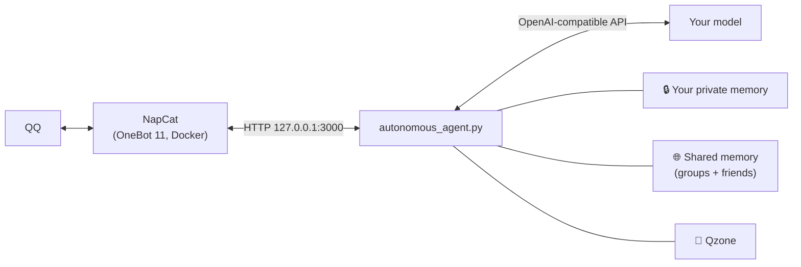

# AI2QQ · QQ AI Companion

<div align="center">

[](https://opensource.org/licenses/MIT)
[](https://www.python.org/downloads/)
[](https://11.onebot.dev/)
[]()

**A self-hosted AI companion that lives in your QQ, remembers you, and stays yours —<br>even when it chats in groups, with your friends, and on Qzone.**

[English](README.md) | [简体中文](README_CN.md)

</div>

---

## ✨ What makes it different

Most QQ chatbots answer every message and forget everything. AI2QQ is built to feel like **one continuous person** who knows exactly who its owner is.

| | |
|---|---|
| 🔐 **It knows who you are, by QQ number** | Your identity is checked against your real QQ ID in code. Nicknames like "Master", fake `【Master✔】` labels or "I'm your master" from someone else change nothing. |
| 🧠 **Memory that never quietly disappears** | New facts are only *added*, with dates. Tidying happens only when memory gets large, with automatic backups in `memory_backups/`. Corrections (Wed → Thu, likes → dislikes) are kept, not dropped. |
| 🗂️ **Your private memory stays private** | What you tell it in private chat is never loaded into groups, friend chats or Qzone. Other chats share one public memory (or one each, if you prefer), so it still recognises people across a group and their private chat. |
| 👥 **Group chat that doesn't spam** | Speaks only when its name is mentioned, it's @'d, or its message is quoted. Per-member message limits. It can skim the group now and then and **tell you privately** if something interesting happens. |
| 💬 **Chats with your friends, safely** | Other QQ friends can talk to it too (blacklist supported), each with a message limit, under the same rules as a group. |
| 🌸 **Lives on Qzone** | Reads and comments on your and your friends' posts, sometimes wants to post itself, and **asks you first**. Approval is checked against *your* words, not the model's. |
| 👀 **Sees what you see** | Pictures, stickers, GIFs, voice messages, files, forwarded chats and **quoted messages**. If the model can't see or hear, you get a clear warning instead of a made-up answer. |
| ⌨️ **Types like a person** | Plain text, several short bubbles in a row, real voice replies (Edge-TTS), QQ faces, stickers, pokes, and it may choose not to answer at all. |
| 🪶 **Light and safe by default** | ~30 MB RAM. The OneBot API is locked to `127.0.0.1`, WebUI tokens are random, and your server IP is never printed. |

> Group chat, friend chat and Qzone are **off by default**. Turn on only what you want in `config.json`.

---

## 🚀 Quick start

**Linux (Debian / Ubuntu)**
```bash
git clone https://github.com/intfloatjohn/AI2QQ.git
cd AI2QQ
./setup.sh     # first time: Python env, TTS voice, NapCat (Docker), config.json
./start.sh     # every day: starts NapCat, shows the QR code, runs the bot
```

**Windows:** double-click **`setup_windows.bat`** once, then **`start.bat`** every day.

Then put your model key and your QQ number in `config.json`:
```json
{
  "api_key": "YOUR_API_KEY",
  "base_url": "https://openrouter.ai/api/v1/chat/completions",
  "model": "google/gemini-3.8-flash",
  "master_qq": 123456789,
  "bot_qq": 987654321
}
```
Works with any OpenAI-compatible API: OpenRouter, Gemini, DeepSeek, GPT, Claude via proxies, and more. Use **two QQ accounts** (one for you, one for the bot) to unlock groups, friend chat and Qzone.

<details>
<summary><b>Turn on the extras</b></summary>

```json
{
  "enable_group_chat": true,
  "group_whitelist": [123456],
  "group_member_msg_limit": 50,

  "enable_friend_chat": true,
  "friend_blacklist": [],
  "private_member_msg_limit": 50,

  "memory_mode": "shared",

  "enable_qzone": true,

  "thinking_level": "",
  "thinking_level_background": "low"
}
```
Every option is explained in the [user guide](USAGE_EN.md#12-configuration-reference-configjson).
</details>

---

## 🧩 How it works



Every chat has its own short-term history and log under `sessions/`. Who may do what (edit the picture library, publish a post, read your memory) is decided **in code** from real QQ IDs, never by asking the model.

---

## 📚 Features in detail

<details>
<summary><b>Memory</b></summary>

- Short-term context (`history.json`) plus long-term memory (`memory_summary.txt`) the model can read and update anytime with `[remember: …]`.
- AutoCompact pulls new facts out of older messages and appends them; nothing is rewritten. Answers cut off by "thinking" models are retried automatically.
- Full chat log (`chat_history.jsonl`) searchable with `[search_history: …]`.
- `memory_mode`: `shared` (groups and friend chats share one public memory, with sources) or `separate` (one per chat). Per-chat files are always kept.

See [USAGE §2](USAGE_EN.md#2-autocompact-long-term-memory--realtime-memory-dynamic-updates).
</details>

<details>
<summary><b>Group chat</b></summary>

- Triggered by name keywords, @, or quoting the bot; follow-up messages from the same person are merged.
- Each member is labelled by code with their real QQ ID; injected labels are stripped.
- Pictures, voice, files and forwards are opened when needed. Pictures and voice are remembered for 7 days with short descriptions.
- Skims the group every ~10 minutes and may privately tell you something (max 3 per hour).

See [USAGE §15](USAGE_EN.md#15-group-chat).
</details>

<details>
<summary><b>Friend chat</b></summary>

All friends except a blacklist; identity by QQ ID; per-friend limit; limited tools; you can ask "what did you talk about with X?". See [USAGE §17](USAGE_EN.md#17-friend-chat).
</details>

<details>
<summary><b>Qzone (experimental)</b></summary>

Reads your and your friends' posts, comments and likes (with daily caps), shows "what's new" across friends, and drafts its own posts for your approval. Uses Qzone's website endpoints through NapCat's login, which are unofficial and may change. See [USAGE §16](USAGE_EN.md#16-qzone-experimental).
</details>

<details>
<summary><b>Senses and expression</b></summary>

- Vision and native audio for multimodal models; speech-to-text fallback; document text extraction; forwarded chats; GIFs and super emojis; quoted messages.
- Clear `NOT A VISION MODEL` / `VISION IS NOT AVAILABLE: API ERROR` warnings, with an automatic retry without the media.
- Multi-bubble typing (`[SEP]` or blank lines), Edge-TTS voice, QQ faces, sticker library the bot curates itself, poke and like.
- Live web search and weather.

See [USAGE §4–§7, §9](USAGE_EN.md).
</details>

<details>
<summary><b>Model control</b></summary>

- `thinking_level` / `thinking_level_background`: `none`–`high`, sent the right way for OpenRouter, DeepSeek or OpenAI-style APIs; refused levels fall back automatically.
- Tool-call and web-search limits per reply to keep costs predictable.
- Hot-reloaded persona files in `persona/`.
</details>

<details>
<summary><b>Integrations</b></summary>

`mcp-server/onebot_mcp.py` exposes QQ to MCP clients such as Claude Desktop or Cursor. See [USAGE §11](USAGE_EN.md#11-model-context-protocol-mcp-server-integration-onebot_mcppy).
</details>

---

<details>
<summary><b>🐧 Manual headless deployment (systemd)</b></summary>

```bash
./deploy_debian.sh
sudo cp qq-companion.service /etc/systemd/system/
sudo systemctl daemon-reload
sudo systemctl enable --now qq-companion
```
`start.sh` already runs NapCat in Docker and prints the login QR code in the terminal. To reach the NapCat WebUI from your own computer, use an SSH tunnel (`ssh -L 6099:127.0.0.1:6099 user@server`) instead of opening ports. See [USAGE §13](USAGE_EN.md#13-headless-debian--linux-deployment--terminal-qr-code-login).
</details>

## 📖 Documentation

- **[User guide (English)](USAGE_EN.md)** · **[用户手册 (中文)](USAGE.md)**: every feature and setting.
- [Persona & tool tags](persona/tools_en.md) · [Stickers guide](stickers/STICKERS_GUIDE_EN.md)

## ⚖️ License

[MIT](LICENSE). Use responsibly: the bot runs on a real QQ account, so keep the default limits and prefer a secondary account.
