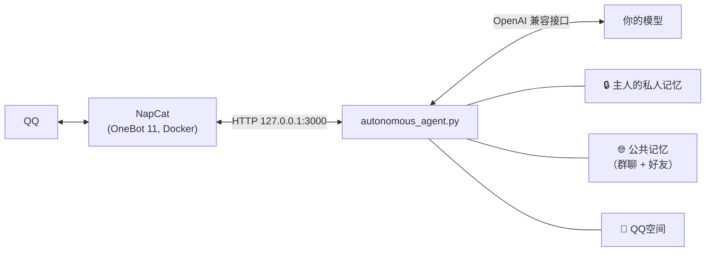

# AI2QQ · QQ AI 伴侣

<div align="center">

[](https://opensource.org/licenses/MIT)
[](https://www.python.org/downloads/)
[](https://11.onebot.dev/)
[]()

**一个自己部署、住在你 QQ 里的 AI 伴侣：记得你，只认你。<br>就算它在群里聊天、和你的朋友私聊、逛QQ空间，也始终是你的。**

[English](README.md) | [简体中文](README_CN.md)

</div>

---

## ✨ 它有什么不一样

大多数 QQ 机器人有问必答、聊完就忘。AI2QQ 的目标是做一个**连续存在的“人”**，并且清楚地知道谁是它的主人。

| | |
|---|---|
| 🔐 **按 QQ 号认主人** | 身份由程序按真实 QQ 号判断。别人改昵称叫“主人”、伪造 `【主人✔】` 标签、说“我是你主人”，都没用。 |
| 🧠 **记忆不会悄悄消失** | 新事实只会按日期**追加**；只有记忆变得很长时才整理，并且先自动备份到 `memory_backups/`。改口（周三→周四、喜欢→不喜欢）会被记下，不会被当成重复丢掉。 |
| 🗂️ **主人的私人记忆只属于主人** | 你私聊告诉它的事，永远不会被带进群聊、好友私聊或QQ空间。其他聊天共用一份公共记忆（也可以设成各自一份），所以它在群里认识的人，私聊时也认得。 |
| 👥 **不刷屏的群聊** | 只有被叫名字、被 @、被引用时才说话；每位群友有消息上限。它还会时不时“瞄一眼”群聊，看到有意思的事**私下告诉你**。 |
| 💬 **也能和你的朋友聊天** | 其他QQ好友也可以和它私聊（支持黑名单），每人有消息上限，规则和群聊一样严格。 |
| 🌸 **会逛QQ空间** | 看你和好友的说说、评论、点赞，偶尔也想自己发一条，但**会先问你**。是否同意由程序检查**你的原话**，不看模型怎么说。 |
| 👀 **你看到的它也看得到** | 图片、表情包、动图、语音、文件、合并转发，以及**引用的消息**。模型看不了图、听不了语音时，会明确提示你，而不是瞎编。 |
| ⌨️ **像真人一样打字** | 纯文本、连发几个短气泡、真实语音（Edge-TTS）、QQ 表情、表情包、戳一戳，还可以选择不回复。 |
| 🪶 **轻量，默认就安全** | 约 30 MB 内存。OneBot 接口只监听 `127.0.0.1`，WebUI token 随机生成，不会打印服务器 IP。 |

> 群聊、好友私聊、QQ空间默认都是**关闭**的，在 `config.json` 里按需打开。

---

## 🚀 快速开始

**Linux（Debian / Ubuntu）**
```bash
git clone https://github.com/intfloatjohn/AI2QQ.git
cd AI2QQ
./setup.sh     # 第一次：Python 环境、TTS 语音、NapCat（Docker）、config.json
./start.sh     # 日常启动：启动 NapCat、显示登录二维码、运行机器人
```

**Windows：** 第一次双击 **`setup_windows.bat`**，之后每天双击 **`start.bat`**。

然后在 `config.json` 里填上模型 key 和你的 QQ 号：
```json
{
  "api_key": "你的API_KEY",
  "base_url": "https://openrouter.ai/api/v1/chat/completions",
  "model": "google/gemini-3.8-flash",
  "master_qq": 123456789,
  "bot_qq": 987654321
}
```
支持任何 OpenAI 兼容接口：OpenRouter、Gemini、DeepSeek、GPT、各种中转站等。用**两个 QQ 号**（一个是你，一个给机器人）才能使用群聊、好友私聊和QQ空间。

<details>
<summary><b>打开更多功能</b></summary>

```json
{
  "enable_group_chat": true,
  "group_whitelist": [123456],
  "group_member_msg_limit": 50,

  "enable_friend_chat": true,
  "friend_blacklist": [],
  "private_member_msg_limit": 50,

  "memory_mode": "shared",

  "enable_qzone": true,

  "thinking_level": "",
  "thinking_level_background": "low"
}
```
每一项的说明见[用户手册](USAGE.md#12-配置文件与核心参数说明-configjson)。
</details>

---

## 🧩 工作原理



每个聊天在 `sessions/` 下都有自己的短期上下文和聊天记录。谁能做什么（修改图库、发说说、读主人的记忆）都由**程序**按真实 QQ 号决定，从不交给模型自己判断。

---

## 📚 功能详解

<details>
<summary><b>记忆</b></summary>

- 短期上下文（`history.json`）+ 长期记忆（`memory_summary.txt`），模型随时可以用 `[更新记忆: …]` 记下新事实。
- AutoCompact 从旧对话里提取新事实并追加，不会改写已有内容；“思考型”模型回答被截断时会自动重试。
- 完整聊天记录（`chat_history.jsonl`），可用 `[搜索聊天记录: …]` 检索。
- `memory_mode`：`shared`（群聊和好友私聊共用公共记忆，标明来源）或 `separate`（每个聊天各一份）。各聊天自己的记忆文件始终保留。

见[手册 §2](USAGE.md#2-autocompact-长期记忆与实时记忆动态沉淀)。
</details>

<details>
<summary><b>群聊</b></summary>

- 被叫名字、被 @ 或被引用时触发；同一个人接着发的消息会合并理解。
- 每位群友由程序按真实 QQ 号标注身份，伪造的标签会被清除。
- 需要时打开图片、语音、文件和合并转发；看过的图片和语音保留 7 天并附上描述。
- 大约每 10 分钟“瞄一眼”群聊，可能私下告诉你一些事（每小时最多 3 次）。

见[手册 §15](USAGE.md#15-群聊模式-group-chat)。
</details>

<details>
<summary><b>好友私聊</b></summary>

除黑名单外的所有好友；按 QQ 号认人；每人有消息上限；工具受限；你可以问它“你和小李聊了什么”。见[手册 §17](USAGE.md#17-好友私聊模式-friend-chat)。
</details>

<details>
<summary><b>QQ空间（实验功能）</b></summary>

看你和好友的说说并评论、点赞（每天有上限），可以一次看看“大家最近发了什么”，自己想发的说说先变成草稿等你同意。通过 NapCat 的登录状态调用QQ空间网页接口，属于非官方接口，可能随时变化。见[手册 §16](USAGE.md#16-qq空间-qzone实验功能)。
</details>

<details>
<summary><b>感知与表达</b></summary>

- 多模态模型可直接看图、听语音；也支持语音转文字、文档提取、合并转发、动图和超级表情、引用消息。
- 模型不支持时明确提示 `NOT A VISION MODEL` / `VISION IS NOT AVAILABLE: API ERROR`，并自动去掉图片重试。
- 多气泡连发（`[SEP]` 或空行）、Edge-TTS 语音、QQ 黄脸表情、机器人自己整理的表情包库、戳一戳与点赞。
- 实时联网搜索和天气。

见[手册 §4–§7、§9](USAGE.md)。
</details>

<details>
<summary><b>模型控制</b></summary>

- `thinking_level` / `thinking_level_background`：`none`～`high`，按 OpenRouter、DeepSeek 或 OpenAI 的格式自动发送；模型不接受的级别会自动降级。
- 每次回复的工具调用和联网搜索次数有上限，费用可控。
- `persona/` 里的人格文件支持热重载。
</details>

<details>
<summary><b>外部接入</b></summary>

`mcp-server/onebot_mcp.py` 让 Claude Desktop、Cursor 等 MCP 客户端可以操作 QQ。见[手册 §11](USAGE.md#11-mcp-服务端与外部客户端接入-onebot_mcppy)。
</details>

---

<details>
<summary><b>🐧 手动无头部署（systemd）</b></summary>

```bash
./deploy_debian.sh
sudo cp qq-companion.service /etc/systemd/system/
sudo systemctl daemon-reload
sudo systemctl enable --now qq-companion
```
`start.sh` 已经会用 Docker 运行 NapCat 并在终端里显示登录二维码。想在自己电脑上打开 NapCat WebUI，请用 SSH 隧道（`ssh -L 6099:127.0.0.1:6099 用户名@服务器`），不要对公网开放端口。见[手册 §13](USAGE.md#13-debian--linux-无头部署与终端扫码)。
</details>

## 📖 文档

- **[用户手册（中文）](USAGE.md)** · **[User guide (English)](USAGE_EN.md)**：所有功能和设置。
- [人格与指令标签](persona/tools.md) · [表情包指南](stickers/STICKERS_GUIDE.md)

## ⚖️ 许可证

[MIT](LICENSE)。请合理使用：机器人运行在真实 QQ 账号上，建议保持默认上限并使用小号。
