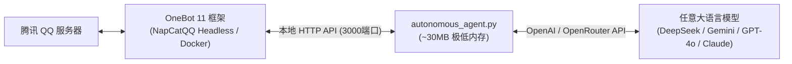

# QQ AI Companion 智能伴侣框架

<div align="center">

[](https://opensource.org/licenses/MIT)
[](https://www.python.org/downloads/)
[](https://11.onebot.dev/)
[]()

**基于 OneBot 11 协议的高性能、超轻量、24 小时无人值守多模态 QQ AI 伴侣/助理开源框架。**

[English](README.md) | [简体中文](README_CN.md)

</div>

---

## 🌟 核心特性

* **⚡ 极低内存占用 (~30MB RAM)**：
  * Python 核心守护进程**仅占约 30MB 内存**，可在 1 核 512MB/1GB 的廉价 Linux VPS 上 24 小时平稳运行。
* **🧠 动态双层记忆与实时更新引擎**：
  * 自动分层记忆体系：`history.json` 保持近期自然上下文；支持模型实时调用 `[更新记忆: 内容]` 随时持久化记住关键事实；当对话轮数达到阈值，自动触发 Auto-Compact 沉淀至 `memory_summary.txt`。长久铭记偏好，消耗极少 Token！
* **📜 全量聊天记录持久化与智能检索**：
  * `chat_history.jsonl` 永久记录每一轮真实对话与时间戳。模型可通过 `[搜索聊天记录: 关键词]` 随时翻阅过去几天甚至几周前谈论过的话题与经历！
* **🔍 实时联网搜索 (Web Search)**：
  * 内置实时互联网搜索支持，模型可通过 `[搜索: 关键词]` 实时获取最新时事、天气、百科与技术资讯。
* **🚀 消息连击缓冲合并 (Smart Debounce & Queue)**：
  * 当用户快速连续发送多句话时，自动等待 1.8 秒打包合并为一条完整语义进行回复，队列化保障不丢任何消息！
* **👁️ 多模态视觉（零报错双通道兜底）**：
  * 支持接收 QQ 图片与表情包。优先通过浏览器头直接下载；若网络拦截，自动回退调用 OneBot 本地缓存接口读取磁盘原图，看图成功率 100%。
* **🎙️ 语音收发与朗读 (Edge-TTS)**：
  * 基于微软云端 Edge Neural TTS，免费、免GPU算力生成真实伴侣语音条（支持 `zh-CN-XiaoyiNeural`、`zh-CN-XiaoxiaoNeural` 等）。支持全自动语音模式与标签发送。
* **🔌 标准 MCP 服务端集成 (Model Context Protocol)**：
  * 内置 `mcp-server/onebot_mcp.py`，可供 Claude Desktop、Cursor、Antigravity 等外部 AI 客户端直接远程调度与操作 QQ 机器人。
* **🎭 全模型秒懂的人格体系**：
  * 人格与规则解耦在 `persona/*.md` 文件中，支持每次对话热重载。提示词杜绝“每句必带表情”的假人感，贴近真人随性自然的打字节奏，字数限制由模型根据语境自主把控。
* **🏷️ 富媒体与交互标签**：
  * 支持在回复中自然嵌入 QQ 黄脸表情（`[发表情: 贴贴]`）、专属贴图（`[发贴图: 比心]`）、真实语音（`[发语音: ...]`）及好友互动（`[互动: 戳一戳]`、`[互动: 点赞]`）。
* **🌐 跨平台无头服务器友好**：
  * 支持 Windows、Debian、Ubuntu、CentOS，支持在无图形界面的 Docker 终端中通过 ASCII 字符画扫码登录。

---

## 🏗️ 架构概览



---

## 🚀 快速上手

### 1. 环境准备
* Python 3.9+ (测试支持至 Python 3.14)
* 任意运行中的 OneBot 11 客户端（推荐 [NapCatQQ](https://github.com/NapNeko/NapCatQQ)）(无需手动配置，setup会自动配置)

### 2. 安装项目依赖
```bash
# 克隆代码仓库
git clone https://github.com/intfloatjohn/AI2QQ.git
cd AI2QQ

# 安装 Python 依赖
pip install -r requirements.txt
```

### 3. 配置参数
复制 `config.example.json` 为 `config.json`，并填入您的信息：
```json
{
  "api_type": "openai",
  "base_url": "https://openrouter.ai/api/v1/chat/completions",
  "api_key": "你的APIKey",
  "model": "google/gemini-3.8-flash",
  "master_qq": 123456789,
  "bot_qq": 987654321,
  "onebot_http_api": "http://127.0.0.1:3000",
  "language": "zh",
  "poll_interval_sec": 1.2,
  "debounce_delay_sec": 1.8,
  "compact_threshold": 14,
  "compact_keep_recent": 6,
  "log_level": "INFO",
  "enable_voice_reply": false,
  "voice_character": "zh-CN-XiaoyiNeural"
}
```

### 4. 快速启动 (One-Click Setup)

#### 🐧 Linux 用户（一键自动配置与启动）：
```bash
chmod +x setup.sh start_agent.sh
./setup.sh
```
> `setup.sh` 会全自动检测/安装 Docker，自动拉取 NapCatQQ 镜像，并在终端直接打印黑白字符扫码登录，随后自动安装 Python 依赖并启动 AI 伴侣！

#### 🪟 Windows 用户（双击运行）：
1. 双击运行 **`setup_windows.bat`**：全自动创建虚拟环境、安装依赖、并可一键自动下载 NapCatQQ 运行环境。
2. 日常启动：配置好 `config.json` 后，双击 **`start_agent.bat`** 即可极速启动！

---

## 🐧 纯命令行 Linux (Debian / Ubuntu) 部署指南

### 1. Docker 部署 NapCatQQ（终端字符画扫码）
```bash
docker run -d \
  --name napcat \
  --restart always \
  --network host \
  -v /opt/napcat/config:/app/napcat/config \
  mlikiowa/napcat-docker:latest
```
直接在终端查看登录二维码：
```bash
docker logs -f napcat
```
终端会直接打印出黑白 ASCII 字符画二维码，手机 QQ 扫描终端即可秒登！

### 2. 部署 AI 伴侣为系统常驻服务 (Systemd)
```bash
chmod +x deploy_debian.sh start_agent.sh
./deploy_debian.sh

# 注册为 systemd 开机自启服务
sudo cp qq-companion.service /etc/systemd/system/
sudo systemctl daemon-reload
sudo systemctl enable --now qq-companion
```

---

## 📖 进阶文档

* [详细使用指南 (USAGE.md)](USAGE.md)：解答如何修改人格、如何调整 AutoCompact 记忆管理、Log 等级配置及语音音色调优。
* [表情贴图管理指南 (stickers/STICKERS_GUIDE.md)](stickers/STICKERS_GUIDE.md)：如何让 AI 自动发现并发送自己的表情包。

---

## ⚖️ 开源许可与合规声明 (License & Legal)

本项目完全采用 **[MIT License](LICENSE)** 授权。
