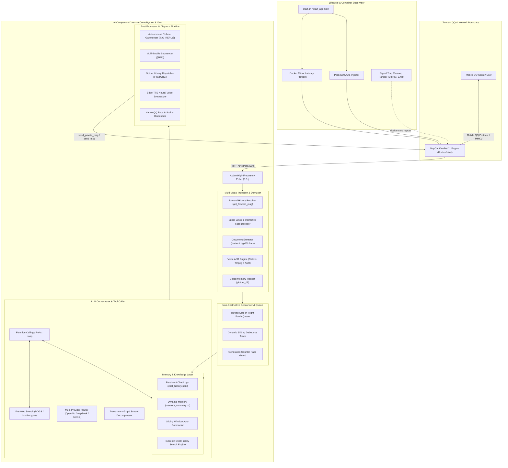

# QQ AI Companion: Full System Architecture & Technology Stack Report

---

## 1. Executive Summary & Design Philosophy

The **QQ AI Companion Framework** (`AI2QQ` / `Gemini_as_catgirl`) is an autonomous, high-availability, 24/7 multi-modal companion daemon for the Tencent QQ ecosystem via the **OneBot 11** standard (powered by NapCat).

Unlike traditional rigid chat-bots that operate on fixed prompt-response cycles, this system implements an **autonomous agentic architecture** designed around real human social habits:
- **Intelligent Non-Destructive Debouncing**: Batches rapid, consecutive user messages without dropping incoming context.
- **Full-Spectrum Multi-Modal Ingestion**: Understands forwarded chat logs, Super Emojis, dynamic GIFs, rich documents (.pdf, .docx, .txt), and voice notes (ASR).
- **Autonomous Agent Agency**: Features model-driven visual memory (`picture_db`), multi-bubble human-like typing (`[SEP]`), and autonomous refusal to respond (`[NO_REPLY]`).
- **Zero Downtime & Self-Healing Ops**: Preflight Docker mirror latency checks, auto-injection of OneBot 11 HTTP bindings, transparent gzip/decompression, and clean signal trap shutdowns.

---

## 2. End-to-End System Architecture



---

## 3. Core Component Pipelines

### 3.1 Multi-Modal Demuxer & Pre-Processor
1. **Forwarded Chat History (`get_forward_msg`)**:
   - Detects `[CQ:forward,id=...]` or node segment payloads.
   - Recursively resolves conversation nodes, formatting timestamps, senders, and nested elements into clean conversational markdown context.
2. **Super Emoji, Animated GIFs & Interactive Faces**:
   - `marketface` segments: Extracts summary/face names (e.g., `[动画表情: 哈哈笑]`).
   - Interactive games: Decodes `dice` (`[掷出骰子: 5点]`) and `rps` (`[猜拳出拳: 剪刀]`).
   - Native QQ faces: Mapped through a bidirectional table (`QQ_FACE_ID_TO_NAME`).
   - GIFs / Memes: Identified by `subType=1` or `.gif` extensions, labeled clearly for LLM context, and downloaded for vision models.
3. **Multi-Format Document Parsing**:
   - Primary: Checks if model natively accepts document parts.
   - Fallback: Local extractor parses plain text (`.txt`, `.md`, `.json`, `.csv`, `.log`, `.py`), PDF (`pypdf`), and Word documents (`python-docx` / XML regex fallback), injecting structured summaries into context.
4. **Voice Message Recognition (ASR)**:
   - Primary: Native audio multi-modal input (e.g., Gemini audio parts).
   - Fallback: OneBot `get_record` audio conversion, local `ffmpeg` 16kHz WAV resampling, and speech-to-text transcription.

### 3.2 Dynamic Visual Memory (`picture_db`)
- **Storage Hierarchy**:
  - `picture_db/images/`: Content-addressed storage using SHA256 hashes (`pic_<sha256>.<ext>`).
  - `picture_db/catalog.json`: In-memory and on-disk catalog indexing metadata (`id`, `timestamp`, `sender_id`, `tags`, `summary`).
- **Autonomous Dispatch**:
  - When LLM outputs `[PICTURE: <keyword>]`, the daemon fuzzy-matches tags in `catalog.json` and `stickers/`, encoding and dispatching the image via OneBot CQ code.

### 3.3 Multi-Bubble Sequencer & Autonomous Refusal
- **Multi-Bubble Sending (`[SEP]`)**:
  - Instead of dumping monolithic text blocks, the model emits `[SEP]` between thoughts.
  - The dispatcher delivers each bubble with a realistic typing delay (default: 1.2s), simulating real human communication.
- **Autonomous Refusal (`[NO_REPLY]`)**:
  - Characters with cold, aloof, or arrogant traits have full agency to stay silent when facing rude or uninteresting messages.
  - When `[NO_REPLY]` is detected:
    - Output to terminal: `[System message] Model refused to reply`.
    - User input is preserved in memory and full logs.
    - Zero outbound messages are sent to QQ.

### 3.4 Self-Healing Operations & Lifecycle Supervisor
- **Docker Latency Preflight**: Tests DaoCloud, DockerPull CN, GHCR, and DockerHub before pulling NapCat.
- **HTTP Port 3000 Auto-Injection**: Injects `httpServers` on port 3000 into `/opt/napcat/config/onebot11*.json` and restarts container when newly created.
- **Signal Trap Cleanup**: Captures `INT`, `TERM`, `SIGHUP`, and `EXIT` in bash (`start.sh`) and Python (`atexit` / signal handler), ensuring `docker stop napcat` runs cleanly whenever the process stops.

---

## 4. Complete Technology Stack

| Category | Component / Library | Purpose |
| :--- | :--- | :--- |
| **Runtime & Language** | Python 3.10 ~ 3.14 | Core asynchronous daemon & poller |
| **OS Shell & Automation** | Bash (POSIX + GNU Coreutils) | Auto-mirror switcher, process supervisor, container cleanup |
| **Bot Protocol & Gateway** | NapCatQQ (OneBot 11 Framework) | Headless QQ NT bridge with WebUI & CQ code API |
| **Containerization** | Docker Engine & Rootless Docker (`sg docker`) | Isolated, cross-platform container runtime for QQ |
| **Networking & HTTP** | `requests`, `urllib.request` | Transparent gzip/deflate decompression, OneBot REST API |
| **Speech & Audio** | `edge-tts`, `ffmpeg` | Neural voice synthesis (Edge-TTS) & Silk/AMR/WAV transcode |
| **Document Processing** | `pypdf`, `python-docx`, `zipfile` | Text extraction from PDF, Word documents, and text files |
| **Vision & Image** | `Pillow (PIL)`, `base64`, `hashlib` | Multi-modal image encoding, SHA256 deduplication |
| **Web Search Engine** | `ddgs` (DuckDuckGo Search) | Real-time live web search with multi-engine fallback |
| **Data Persistence** | JSON, JSON Lines (`.jsonl`), UTF-8 | Full chat logs, rolling memory summaries, visual catalogs |

---

## 5. Storage & Data Schema Reference

### 5.1 Visual Catalog (`picture_db/catalog.json`)
```json
[
  {
    "id": "3483bec64419a849",
    "filename": "pic_3483bec64419a849.png",
    "path": "picture_db/images/pic_3483bec64419a849.png",
    "timestamp": 1730123456,
    "sender_id": 123456789,
    "tags": ["表情包", "动图", "猫猫"],
    "summary": "猫猫比心动态表情"
  }
]
```

### 5.2 Full Chat History Log (`chat_history.jsonl`)
```json
{"timestamp": "2026-10-28 21:40:00", "sender_id": 123456789, "role": "user", "text": "今晚吃啥？", "has_image": false, "msg_id": 1001}
{"timestamp": "2026-10-28 21:40:03", "sender_id": 987654321, "role": "assistant", "text": "去吃热腾腾的拉面怎么样？[SEP]我知道附近新开了一家超赞的！", "has_image": false, "msg_id": 1002}
```

---

## 6. Configuration Options Reference (`config.json`)

```json
{
  "api_type": "openai",
  "base_url": "https://api.deepseek.com/v1",
  "api_key": "sk-your-key-here",
  "model": "deepseek-flash",
  "master_qq": 123456789,
  "bot_qq": 987654321,
  "onebot_http_api": "http://127.0.0.1:3000",
  "language": "zh",
  "poll_interval_sec": 0.8,
  "debounce_delay_sec": 2.2,
  "compact_threshold": 30,
  "compact_keep_recent": 12,
  "max_tokens": 1200,
  "enable_web_search": true,
  "max_search_results": 4,
  "enable_voice_reply": false,
  "voice_character": "zh-CN-XiaoyiNeural",
  "enable_file_parser": true,
  "prefer_native_file_parser": true,
  "enable_voice_recognition": true,
  "prefer_native_voice_recognition": true,
  "enable_picture_database": true,
  "enable_multi_bubble_reply": true,
  "multi_bubble_delay_sec": 1.2,
  "enable_autonomous_refusal": true
}
```
